<!-- Cards are rendered by scripts/build.py (content in scripts/profile.json).
     assets/*.svg are static; output-branch cards are rebuilt every 6h by .github/workflows/profile.yml -->



  <a href="https://github.com/Wayzinx/taktflow"></a>
  <a href="https://github.com/Wayzinx/interview-review"></a>
  
  <a href="https://github.com/Wayzinx/browser-nav-assistant"></a>
  <a href="https://github.com/Wayzinx/astrbot-food-recommender"></a>
  





<picture>
  <source media="(prefers-color-scheme: dark)" srcset="https://raw.githubusercontent.com/Wayzinx/Wayzinx/output/pacman-contribution-graph-dark.svg">
  
</picture>

<b>🕹️ INSERT COIN — more games on my contribution graph</b>

 

<picture>
  <source media="(prefers-color-scheme: dark)" srcset="https://raw.githubusercontent.com/Wayzinx/Wayzinx/output/galaga-contribution-graph-dark.svg">
  
</picture>
<picture>
  <source media="(prefers-color-scheme: dark)" srcset="https://raw.githubusercontent.com/Wayzinx/Wayzinx/output/bomberman-contribution-graph-dark.svg">
  
</picture>
<picture>
  <source media="(prefers-color-scheme: dark)" srcset="https://raw.githubusercontent.com/Wayzinx/Wayzinx/output/breakout-contribution-graph-dark.svg">
  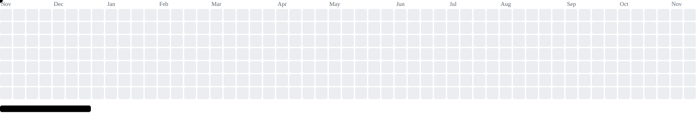
</picture>
<picture>
  <source media="(prefers-color-scheme: dark)" srcset="https://raw.githubusercontent.com/Wayzinx/Wayzinx/output/github-contribution-grid-snake-dark.svg">
  
</picture>


<b>🖥️ Full battle-station specs</b>

 

| Slot | Gear |
| --- | --- |
| 🎮 Handheld | Nintendo Switch OLED |
| 🎮 Console | PlayStation 5 |
| 🧠 CPU | Ultra 9 275HX |
| 🎨 GPU | RTX 5080 |
| ⚡ RAM | 32GB DDR5 |
| 💾 Storage | 1TB NVMe SSD |
| 🖥️ Display | Asus ROG Strix 27" 2K HDR Gaming Monitor (XG27AQM) |
| 🧩 Motherboard | Asus ROG MAXIMUS Z790 HERO |
| 🖱️ Mouse | SteelSeries Prime Mini Wireless |
| ⌨️ Keyboard | ROG Azoth Ace HFX |

